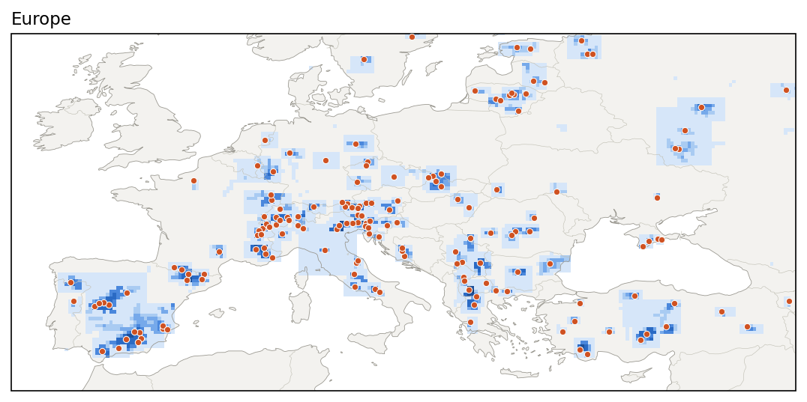

# Pre-task Analyzer

ML model for analyzing paragliding competition tasks. CS 457 Intro to AI final project, Boise State University, Fall 2026. Roberto Jones.

Before a task is set, the task committee enters the task they have in mind (turnpoints, cylinders, start, goal), the day's forecast and the pilots entered. The analyzer returns:

- the expected share of pilots in goal (with a range), the winner's time and a difficulty index;
- the likely route over the predicted thermals, and the legs where many pilots land out on days like this;
- two or three alternative tasks that land in the committee's target (for example 40–70% in goal), each with its chance of success.

The Meet Director always makes the decision; the tool only advises.

## Results so far

- **Data:** 848 competitions, 3,114 tasks, 173,280 results and 152,930 unique competition flights at 291 sites; 18.6 M crossings of 1 km cells and 3.0 M thermals, with heights above the ground calibrated on each flight's landing.
- **Weather:** hourly ERA5 (surface, pressure levels, ground and air mass) and ERA5-Land for every site and competition day.
- **Pilots:** an Elo rating before every task; the pilot rated higher placed better in 72.8% of pairs.
- **Task model:** winner's time within 17 min on competitions it never saw (58% of tasks within 15 min; without weather 18 min and 53%; a simple rule 22 min). The weather it uses most is the wind along the route. Goal share within 19 points, barely better than without weather: the committees already set the tasks for the forecast.
- **Thermals:** ERA5's boundary layer tells a high day from a low one at the same site (day-to-day correlation with the pilots' ceiling 0.64 over 136 sites). Per cell crossing, the first thermal model is well calibrated but modest (AUC 0.67 on sites it never saw): whether a pilot climbs depends a lot on the pilot.
- **Wind:** ERA5's prevailing wind agrees with what pilots measured in their thermals to 16° in direction (74% within 30°); near the ground, where the terrain takes over, only 63%.

The full log, step by step: [docs/results.md](docs/results.md). Statistics of the database and maps: [results/STATS.md](results/STATS.md), with interactive maps of the [sites](results/sites.geojson), the [weather chips](results/chips.geojson) and the [cells crossed most often](results/thermal_cells.geojson).



## How it works

| Part | What it does |
|---|---|
| Chips | A grid aligned with the weather model (ERA5, about 27 km), with 1 km cells inside for terrain, sunlight on slopes, climbs and landouts, by hour and type of day |
| Pilot profiles | Speed relative to the winner, goal rate, consistency and style from each pilot's past tracks, plus a results-based rating; only flights before the task are used |
| Task model | Predicts goal share, winner time and difficulty from the route, the weather, the chips it crosses and the strength of the field |
| Route planner | A* over the predicted thermals, with wind and speed-to-fly |
| Alternatives | Builds candidate tasks from the competition's waypoints under the committee's rules and keeps the ones in the target |

The general thermal and landout model, its labels, features and evaluation are described in [docs/model_design.md](docs/model_design.md). How the parts connect, with diagrams: [docs/architecture.md](docs/architecture.md), and an interactive graph of the code and docs at [pta.xcmeteo.com/graph/](https://pta.xcmeteo.com/graph/).

Data: competition IGC tracks (Flymaster, AirScore, Airtribune and civlcomps.org), task definitions and official results; ERA5 and HRRR weather; Copernicus GLO-30 terrain.

## Repo layout

```
notebooks/   step-by-step notebooks (run in Colab, in order)
scripts/     command-line steps
pta/         shared code: IGC reader, results parsers, flight analysis, the global grid and terrain
docs/        design notes (architecture.md: how the parts connect; model_design.md: the general model; database.md: the tables; deployment.md: how it will be served; results.md: what each step produced)
api/         the API that re-plans a task with a new route (FastAPI, on the OptiPlex behind a Cloudflare Tunnel)
web/         the web page (Astro + MapLibre on Cloudflare Pages)
results/     statistics and coverage maps of the database, refreshed every 10 to 15 commits (notebook 12)
data/        small tables only (catalogs); tracks live in Google Drive
```

## Steps

| # | File | What it does | Output |
|---|------|--------------|--------|
| 1 | `notebooks/01_download_flymaster.ipynb` | Lists every Flymaster task with a public IGC package (`scripts/scan_flymaster.py`), then downloads each paragliding task into the project's Drive folder: IGC package, task definition and results page (`scripts/download_flymaster.py`) | `flymaster_igc/flymaster_catalog.csv` and `flymaster_igc/<group>/` in Drive |
| 2 | `notebooks/02_download_airscore.ipynb` | Downloads every finished paragliding competition on FAI AirScore (`scripts/airscore.py`): IGC package and results page per task | `airscore_igc/airscore_catalog.csv` and `airscore_igc/<comp_id>/` in Drive |
| 3 | `notebooks/03_download_airtribune.ipynb` | Downloads every past paragliding event on Airtribune, 2012 to today (`scripts/airtribune.py`), with the administrators' permission: track archive and results page per task | `airtribune_igc/airtribune_catalog.csv` and `airtribune_igc/<event_id>/` in Drive |
| 3b | `notebooks/03b_download_civlcomps.ipynb` | Downloads the paragliding XC events published on CIVL's event portal civlcomps.org (`scripts/civlcomps.py`), with CIVL's permission: IGC zip, FS results page and participants per task (IGC uploads began in 2024) | `civlcomps_igc/civlcomps_catalog.csv` and `civlcomps_igc/<event_id>/` in Drive |
| 4 | `notebooks/04_build_catalog.ipynb` | Fetches the Airtribune task results still missing, then reads every task package and results page into the database tables (`scripts/build_catalog.py`, `pta/`) | `database/*.parquet` in Drive, described in [docs/database.md](docs/database.md) |
| 5 | `notebooks/05_build_flights.ipynb` | Analyses every unique track (`scripts/build_flights.py`, `pta/flight.py`): cleans GPS and altitude errors, separates the flight from the drive up and the retrieve, and splits it into climbs and glides | `database/flights`, `climbs`, `glides` and `fixes/` (5 s fixes per task) |
| 6 | `notebooks/06_sites_terrain.ipynb` | Groups the competitions into flying sites (`scripts/build_sites.py`), downloads the Copernicus GLO-30 DEM around them and describes the terrain of every 1 km cell (`scripts/build_terrain.py`, `pta/terrain.py`, `pta/grid.py`) | `database/sites`, `event_sites`, `site_chips`, `cells`; `dem/glo30/` tiles |
| 7 | `notebooks/07_weather_era5.ipynb` | Hourly ERA5 (single and pressure levels) and ERA5-Land for every site on its competition days, from the Copernicus Climate Data Store (`scripts/era5.py`; needs a free CDS key), and a first check of ERA5's boundary-layer height against real thermal tops | `database/weather/era5_single`, `era5_levels`, `era5_land` |
| 7b | `notebooks/07b_weather_arco.ipynb` | The same ERA5 single levels read from ARCO-ERA5, Google's public copy of ERA5 on Cloud Storage (`scripts/era5_arco.py`; no key, no queue, far faster than the CDS), for each site's competition days from 5 to 21 h local solar time | `database/weather/arco/single/`, merged into `era5_single` |
| 7c | `notebooks/07c_weather_arco_levels.ipynb` | ERA5 pressure levels from ARCO-ERA5, every 3rd hour (each read brings all 37 levels of the world); notebook 07 then asks the CDS only for ERA5-Land | `database/weather/arco/levels/`, merged into `era5_levels` |
| 7d | `notebooks/07d_weather_arco_extra.ipynb` | More from ARCO-ERA5: ERA5's own ground height, land share, vegetation and soil per chip, and hourly skin temperature, soil moisture, albedo, snow depth, water vapour, freezing level, convective rain and friction velocity | `database/weather/era5_static`, `era5_extra` |
| 7e | `notebooks/07e_weather_gee_land.ipynb` | ERA5-Land from Google Earth Engine (`scripts/era5_land_gee.py`, `ECMWF/ERA5_LAND/HOURLY`): the same `era5_land` table as notebook 07, one request per site and competition day, in hours instead of days in the CDS queue | `database/weather/gee/land/`, merged into `era5_land` |
| 8 | `notebooks/08_crossings_labels.ipynb` | Labels from the flights (`scripts/build_crossings.py`): height above ground of every fix, drives down from launch removed, the 1 km cells each flight crossed and whether it climbed there, every thermal's base and top above ground with the wind the pilot measured and its trigger point, and every landing | `database/flight_checks`, `crossings`, `thermals`, `landings` |
| 9 | `notebooks/09_thermal_model.ipynb` | Thermal model v0 (`scripts/thermal_model.py`): the chance that a pilot crossing a 1 km cell finds a climb, from height on arrival, terrain, sun on the slopes and ERA5, scored on sites left out and compared group by group; the pilots' ceilings against ERA5's boundary layer; the data for the web page (`scripts/export_web.py`) | `database/models/thermal_v0/`, `database/web_data/` |
| 10 | `notebooks/10_task_basics.ipynb` | Glider models and classes (`scripts/gliders.py`), Elo pilot ratings before every task and field strength (`scripts/pilot_ratings.py`), and the task baseline without weather: winner's speed and time and goal share (`scripts/task_baseline.py`) | `database/result_gliders`, `gliders`, `ratings`, `pilot_ratings`, `task_fields`, `models/task_v0/` |
| 11 | `notebooks/11_wind_check.ipynb` | The wind pilots measured in their thermals against ERA5's wind at the same place, hour and height (`scripts/wind_check.py`), pooled by site, hour and height band: near the ground (what a terrain-flow model has to get right), middle, and free air (the prevailing wind such a model takes as input) | `database/models/wind_check/` |
| 12 | `notebooks/12_repo_stats.ipynb` | Statistics and coverage maps of the database for the repo (`scripts/repo_stats.py`): totals, by year, source and country, the sites, gliders, ratings and the models' latest scores; maps of the sites, weather chips and most-crossed cells (`.geojson`, which GitHub draws on a map, and `.png`). Counts and aggregates only | `results/` in the repo |
| 13 | `notebooks/13_task_model.ipynb` | Task model v1 (`scripts/task_model.py`): winner's time and goal share from the committee's information plus the weather along the route during the task (boundary layer, cloud base, heat flux, CAPE, lapse rate, tailwind and crosswind per leg, ground); scored against the no-weather baseline on the same folds; writes the model as JSON for the browser and each site's tasks for the web page | `database/models/task_v1/`, `database/web_data/task_model.json`, `web_data/tasks/` |
| 14 | `notebooks/14_forecast_wind_weights.ipynb` | Verifies archived Open-Meteo forecasts (global and regional models) against the winds pilots measured in thermals alongside ERA5 (`scripts/forecast_wind_weights.py`), validates skill-weighted blends with 5-fold competition-grouped CV, and exports empirical blend weights | `database/weather/hist_forecast/`, `database/models/forecast_wind_weights/`, `database/web_data/forecast_weights.json` |
| 15 | `notebooks/15_igc_truth.ipynb` | Builds a calibrated multi-variable atmospheric ground-truth dataset directly from the 5 s `fixes/` (`scripts/build_igc_truth.py`, `pta/igc_truth.py`): dual-DEM altitude tiers, phase-free hodograph + integer-turn thermal winds with vertical slicing, independent multi-heading glide winds, multi-pilot ASL top-of-lift with airspace-cap flagging, 60 s/30 s core climb rates, task-level physical summaries, and a raw 1 Hz vs 5 s sensor audit | `database/truth/` (`truth_flights`, `truth_thermals`, `truth_wind_groups`, `truth_glide_wind`, `truth_ceiling`, `truth_climb_groups`, `truth_daily`, `truth_tasks`, `audit_1hz_vs_5s.json`) |
| 16 | `notebooks/16_forecast_multivar_eval.ipynb` | Multi-variable verification of the 9 archived Open-Meteo forecast models against `database/truth/` (`scripts/forecast_multivar_eval.py`): offline clean-wind re-scoring, resumable thermodynamic cache, ASL top-of-lift and parcel-BLH trigger CV, `core60_p75` climb skill, leakage-free end-to-end `task_v1` evaluation with monotone quantile mapping to ERA5, and composite multi-pillar weights | `database/weather/hist_forecast_thermo/`, `database/models/forecast_multivar_eval/` (`forecast_calibration.json`, `forecast_multivar_weights.json`) |

The tracks are too big for git. They live in the project's Google Drive folder.

## Next steps

Done so far: the database (01–08), the weather (07, 07b–07e), the thermal model v0 (09), gliders, ratings and the task baseline (10), the wind check (11), the task model with weather (13), the web demo with its task planner, and the API. Step by step from here:

1. **Live tasks with forecasts:** live multi-model Open-Meteo forecasts (ECMWF IFS, ECMWF AIFS, GFS, ICON, GEM, plus regional RRFS, HRDPS, ICON-D2, ICON-EU and AROME where covered) with a Median/Mean blend and uncertainty range are wired into the API and task planner. Next: hindcast verification and bias correction (quantile mapping to ERA5) using Open-Meteo Historical Forecasts and pilot-measured winds from IGC tracks to weight models by site; then the likely route over the predicted thermals and alternative tasks that land in the committee's target.
2. **Task model v2:** the weather hour by hour along the route rather than averaged over the task window; each pilot's result (goal, time) from rating, glider and harness, added up into the goal share; the thermal model's predictions along the legs.
3. **Thermal model v1:** a label without the pilot's choice (searching crossings; cells by day), gaggles, ERA5-Land at 0.1°, day-level models of ceiling and climb rate.
4. **Energy on the slopes and wind over the terrain:** sunlight with shading by neighbouring mountains, clouds, albedo and land cover; trigger points traced upwind; WindNinja per site, and the CFD surrogate (OpenFOAM, the user's own) kept if it beats WindNinja against the winds pilots measured (notebook 11 gives the bar: 63% within 30° near the ground).
5. **Regional weather layers:** HRRR (United States), CERRA (Europe); radiosonde soundings (IGRA2) for validation.
6. **Web:** the terrain from the project's own Copernicus GLO-30 tiles (as in ParaglidingMeteograms) in place of the public Terrain Tiles, the thermal model's predictions at the hotspots' resolution, and the analyzer inside xcmeteo.com with sign-in.

The web page (`web/`, Astro + MapLibre on Cloudflare Pages) maps the sites and, per site, where pilots circled in thermals (cells of about 200 m), how often they found a climb in each 1 km cell and what the thermal model predicts, in 2D or on the terrain in 3D, and the site's tasks with the task model's predictions. Its task planner sets a task on the map for a past day (turnpoints, cylinders, start and deadline, optimized distances as in FAI S7F), reads and writes the formats flight instruments use (XCTrack QR code and `.xctsk`, SeeYou `.cup`, Flymaster and CompeGPS `.wpt`, GPX) and asks the API what the task model predicts for it; see [web/README.md](web/README.md).

The models are described in [docs/model_design.md](docs/model_design.md).
