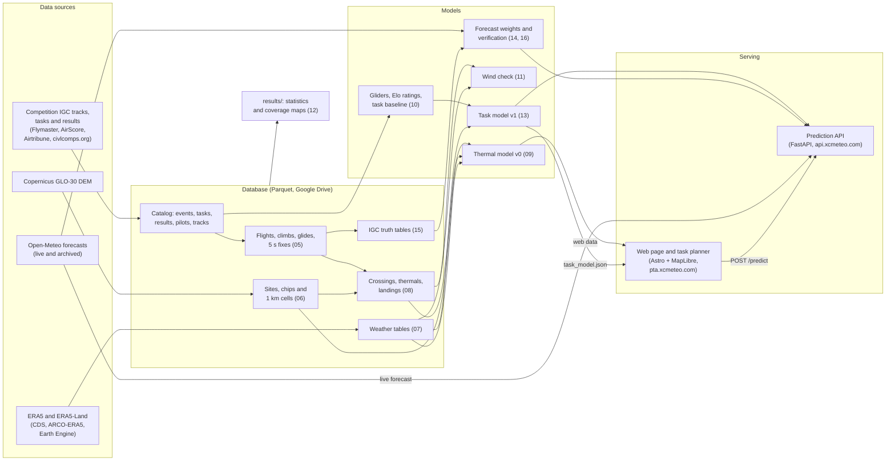
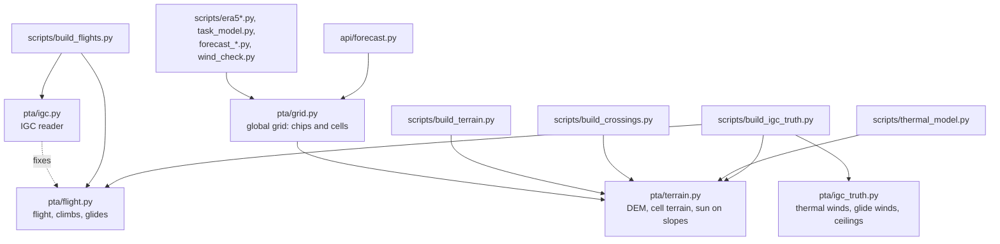

# Architecture

How the parts of the project fit together: where the data comes from, how the database and the models are built, and how the API and the web page use them.

**Interactive graph:** [pta.xcmeteo.com/graph/](https://pta.xcmeteo.com/graph/) maps the code and the docs as a graph (about 1,000 functions, files, tables and concepts, grouped into communities). Click a node to see its connections, or search for a function or a table.

## Overview

Numbers in brackets are the notebooks in `notebooks/` that build each part; the README's [Steps](../README.md#steps) table lists them one by one.

## The shared code

Arrows are imports (`terrain.py` imports `grid.py`, so the scripts that use the terrain also use the grid); the dotted arrow is data: `pta/flight.py` works on the fixes `pta/igc.py` reads.

- **The grid** (`pta/grid.py`) is the key every table shares: 0.25° chips aligned with ERA5, and 1 km cells inside them. Weather joins on `chip_id`, terrain and crossings on `cell_id` ([database.md](database.md)).
- **Sun on the slopes** (`pta.terrain.sun_on_cell`) turns each cell's share of slopes and aspects (stored in the `cells` table) into direct sunlight for any sun position. The thermal model uses it for its `sun_direct` and `sun_energy` features. Shading by neighbouring mountains, clouds and albedo are the planned extension ([model_design.md](model_design.md)).
- **The web page** (`web/src/scripts/`) runs the task model in the browser from `task_model.json` and asks the API only to re-plan a task with a new route or a live forecast.
