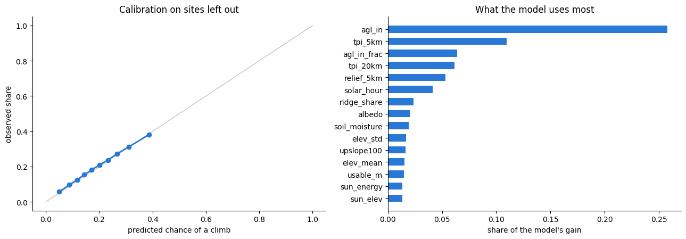

# Results log

What each step has produced on the full database, in the order the notebooks run. Numbers are copied from the notebooks' output; `results/` holds the statistics and maps generated from the database itself (notebook 12). Both are refreshed every 10 to 15 commits.

Last update: 24 November 2026 (15 added).

## Database

| Step | Result |
|---|---|
| 04 catalog | 848 competitions, 3,114 tasks (2,325 with results), 173,280 results, 12,495 pilots (9,841 with a CIVL ID) |
| 04 tracks | 196,975 tracks, 165,112 unique, 87% linked to a result. Unique tracks by source: Airtribune 79,448, CIVL comps 64,971, AirScore 12,873, Flymaster 7,820 |
| 05 flights | 160,223 flights; 7,293 copies of the same flight, so 152,930 unique. 3.72 M climbs (3.1 M thermals) and 3.86 M glides. Median flight: 2.6 h, 20 thermals, 1.5 m/s, 32% of the time circling |
| 06 sites and terrain | 291 sites from 822 competitions; 6,270 ERA5 chips (0.25°) and about 3.9 M cells of 1 km; 906 GLO-30 DEM tiles; 282.6 M fixes |
| 08 crossings and labels | 152,930 flights checked, 2,173 of them drives (a 'flight' on the ground); 18,603,747 cell crossings; 2,959,898 thermals; 152,930 landings |

### Height above the ground (08)

Heights are calibrated per flight on its landing (logger altitude error, geoid): 76% of flights calibrated, median offset 15 m (10–90%: 1 to 97 m). Landings: median 30 m above the ground before calibration, −1 m after (−1 m for pilots who landed out, −2 m in goal).

Median height above the ground in flight: 580 m. Thermals: base 517 m and top 715 m above the ground (median); wind measured in 68% of them, median 2.2 m/s.

| Solar hour | Thermals | Base (m) | Top (m) | Climb (m/s) |
|---|---|---|---|---|
| 10 | 35,952 | 260 | 415 | 1.14 |
| 11 | 337,466 | 401 | 568 | 1.21 |
| 12 | 786,374 | 494 | 675 | 1.27 |
| 13 | 856,800 | 549 | 757 | 1.43 |
| 14 | 620,418 | 576 | 800 | 1.47 |
| 15 | 259,103 | 556 | 773 | 1.35 |
| 16 | 55,117 | 498 | 693 | 1.18 |
| 17 | 5,489 | 477 | 649 | 0.99 |

## Weather (07, 07b–07e)

| Table | Source | Rows | Chips | Days | Notes |
|---|---|---|---|---|---|
| `era5_single` | ARCO-ERA5 (+ CDS files) | 8,014,876 | 6,270 | 2,083 | 38,890 hours, 816,690 global fields read in 3.3 h |
| `era5_levels` | ARCO-ERA5 (+ CDS files) | 2,581,720 | 6,270 | 2,073 | every 3rd hour; 65,170 global fields of 37 levels in about 9.5 h |
| `era5_extra` | ARCO-ERA5 | 3,964,016 | 6,270 | 2,083 | ground and air-mass variables |
| `era5_land` | Earth Engine (+ CDS files) | 63,561,788 | 6,249 | 2,084 | 47,337 ERA5-Land points (0.1°); 3,969 site-days in about 20 min |
| `era5_static` | ARCO-ERA5 | one row per chip | 6,270 | | ERA5's ground height, land, vegetation, soil |

Reading from the CDS queue would have taken about a week for the same data. 0.015% of ERA5-Land rows have extreme fluxes near solar noon (sunshine above 1,100 W/m² at high, clear sites; strongly negative sensible heat over snow), kept as they are.

## Gliders and pilot ratings (10)

- 98% of results name a glider: 7,412 spellings become 2,256 models; the class is found for 94.2% (declared by the results themselves). Classes: CCC 33.4%, EN-C 33.3%, EN-D 21.3%, EN-B 11.7%, EN-A 0.2%. Most flown: Ozone Enzo 3 (35,784 results), Zeno 2, Photon, Niviuk X-One, Zeno.
- A harness is written after the wing in 13.9% of results (404 models); most common: Ozone Submarine (8,543), Gin Genie Race 5.
- Pilot ratings (Elo, before every task): 2,272 tasks, 12,060 pilots (2,181 with 20+ tasks), ratings 999 to 2,366. **In 72.8% of pairs of pilots, the one rated higher before the task placed better** (50% would be chance). The strongest fields are PWC and world championships.

## Task baseline without weather (10)

2,099 tasks with results and 10+ pilots (1,811 with a winner's time), 246 sites, 679 competitions. Scored on competitions left out and on sites left out, against two simple rules.

| Target | Model, new competition | Model, new site | Median of all tasks | Site history |
|---|---|---|---|---|
| Winner's speed | 4.9 km/h | 5.2 km/h | 6.1 km/h | 5.6 km/h |
| Winner's time | 18 min | 19 min | 22 min | |
| Goal share | 19.6 points | 20.5 points | 26.0 points | 22.7 points |

Without weather the model stays close to the average: long days (3 to 4.7 h) are predicted at 2 to 3.5 h. This is the bar the weather has to beat. Most used: the site's history, the speed-section distance, latitude, the field's top-10 rating, the start time.

## Wind: pilots vs ERA5 (11)

2,006,426 thermals with a measured wind (the drift of their circles) at 280 sites, against ERA5 interpolated to the same place, hour and height; pooled into 34,892 groups (site, chip, hour, height band) of 3+ thermals from 2+ flights.

| Band | Groups | Vector error | Speed bias (pilots − ERA5) | Speed correlation | Direction error | Within 30° |
|---|---|---|---|---|---|---|
| near the ground (< 400 m) | 12,121 | 1.8 m/s | −0.5 m/s | 0.39 | 22° | 63% |
| middle (400–1000 m) | 10,988 | 1.8 m/s | −0.5 m/s | 0.45 | 22° | 64% |
| free air (> 1000 m or above the crests) | 11,783 | 1.8 m/s | −0.6 m/s | 0.61 | 16° | 74% |

- ERA5's prevailing wind (free air) is a sound input for a terrain-flow model; near the ground the terrain takes over (correlation 0.39). 63% within 30° and a correlation of 0.39 are the numbers a terrain-flow model (WindNinja, the CFD surrogate) has to beat.
- Pilots measure about 0.5 m/s less than ERA5, most in the late morning (−1.1 m/s at 11 h solar, about 0 by 17 h): partly circles re-centred on the core, partly ERA5's morning boundary-layer wind.
- By site: flat or synoptic sites agree best (Konchinka, Russia: 9°, 94% within 30°; Pegalajar and Piedrahita, Spain: 80–87%); tropical mountain sites worst (Roldanillo, Colombia: 45°, 33%; Valle de Bravo, Mexico: 37°, 44%), where valley and slope winds rule and ERA5 does not resolve them.

## Ceiling: pilots vs ERA5's boundary layer (09)

The pilots' ceiling (90th percentile of thermal tops per chip and hour, 5+ thermals, calibrated heights) against ERA5's boundary-layer height, both above ERA5's own ground: 18,251 chip-hours.

- Median ceiling 1,151 m against a boundary layer of 1,516 m: pilots top out at about three quarters of it (they leave thermals before the top, and the top of a thermal is below the top of the mixed layer).
- Correlation 0.61 over all chip-hours (0.25 with ERA5's cloud base).
- **Day to day within a site: median correlation 0.64 over 136 sites with 5+ days.** ERA5 tells a high day from a low one at the same site.

## Thermal model v0 (09)

The chance that a pilot crossing a 1 km cell finds a climb (30 s or more climbing), from height on arrival, terrain, sun on the slopes and ERA5. 4,000,000 crossings sampled from 18.6 M (286 sites, 2,673 tasks); base rate 20.3%. Scored on sites left out (5 folds).

| Features | AUC | Log-loss skill | Brier |
|---|---|---|---|
| pilot + terrain (15) | 0.654 | +4.8% | 0.1540 |
| + sun (19) | 0.662 | +5.4% | 0.1531 |
| + weather (51) | 0.671 | +5.9% | 0.1523 |

- Calibration on held-out sites is close to exact: predicted 5.0% → observed 5.7%, 20.1% → 21.0%, 38.6% → 38.1%.
- The climb rate when there is a climb is hard to predict per crossing: R² 0.095, mean error 0.55 m/s (mean 1.65 m/s, 810,296 climbs).
- Most used: height on arrival (25.8%), topographic position at 5 and 20 km (17%), height as a share of the usable boundary layer (6.4%), relief, solar hour, ridges, albedo, soil moisture.

Reading: per crossing, whether a pilot climbs depends as much on the pilot (how low they are, whether they need a climb, whether others are already circling) as on the air, so the gains from each group are small even though each is real. The weather sets the *day* (the ceiling result above), the terrain sets *where*. Next version: a label that removes the pilot's choice (crossings low enough to be searching; cells by day rather than by crossing), gaggles as a feature, ERA5-Land at 0.1°, and day-level models of ceiling and climb rate.

Web data: 34,692 cells with 20+ crossings at 247 sites (1.2 MB).

## Task model v1 with weather (13)

The same 2,099 tasks (1,811 with a winner's time) as the baseline, with the weather of the day along the route during the task (96% of tasks have weather; 79% along their real route, the rest over the competition area). Both models scored on the same folds.

| | Without weather | With weather |
|---|---|---|
| Winner's time, new competition | 18 min | **17 min** |
| within 15 min | 53% | **58%** |
| within 30 min | 83% | **86%** |
| Winner's speed, new competition | 4.9 km/h | **4.4 km/h** |
| Winner's time, new site | 20 min | **18 min** |
| Goal share, new competition | 19.6 points | 19.0 points |
| Goal share, new site | 20.7 points | 20.5 points |

- The weather improves the winner's speed by about 10% (4.9 to 4.4 km/h) and puts 58% of tasks within 15 minutes. What it uses most is the **wind along the route**: tailwind at 100 m and at 700 hPa come right after the site's history, then the boundary layer and the lapse rate.
- The goal share barely moves. The committee already set each task for the forecast it had (longer tasks on better days), so the distance carries much of the weather; what is left depends on the pilots and on local conditions that 0.25° ERA5 averaged over five hours does not see.
- Next: predict each pilot's result (goal or not, time) from the pilot's rating and glider and the weather, and add them up into the goal share: 173,280 results to learn from instead of 2,099 tasks. Also the weather by hour along the route (how the day develops), the wind at the pilots' height, and the thermal model's predictions along the legs.

## IGC atmospheric truth (15)

Calibrated multi-variable ground-truth dataset built directly from the 5 s `fixes/` across `149,052` unique flights (`2,523` tasks, `2,284,536` thermals, `2,458,498` vertical slices) without re-parsing raw zip archives (`scripts/build_igc_truth.py`, `pta/igc_truth.py`).

- **Dual-DEM altitude calibration (`truth_flights`):** `80,226` `gold` (`53.8%`, `step <= 2 s`, median offset `11.4 m`, median takeoff–landing drift `9.3 m`), `33,157` `silver` (`22.2%`, landing-calibrated), and `35,669` `excluded` (`23.9%`, uncalibrated with median drift `278.1 m`).
- **1 Hz raw IGC vs 5 s `fixes/` audit (`292` flights, `6,648` matched thermals):** verdict **`5s_sufficient`** — clean wind `RMSE = 0.115 m/s` (median `0.071 m/s`, bias `−0.0015 m/s`), peak 60 s core climb `MAE = 0.018 m/s` (`r = 0.9988`, bias `0.0`), 30 s core climb `MAE = 0.038 m/s` (`r = 0.9968`), thermal top `MAE = 0.45 m` (`r = 1.0000`, p95 `2.0 m`). Re-parsing the 153k raw zip archives is unnecessary for atmospheric verification.
- **Clean wind (`truth_wind_groups`, `31,701` groups; `truth_glide_wind`, `12,944` groups):** combining the Huber velocity hodograph and air-relative integer-turn drift shrinks the speed bias against ERA5 in `free air + middle` from `−0.531 m/s` (legacy endpoint drift) to `−0.387 m/s` (`−0.279 m/s` hodograph-only) and raises speed correlation across every band (`0.402 → 0.429` near ground, `0.603 → 0.612` free air). Cross-checking against `12,217` independent multi-heading glide-wind groups confirms clean thermal wind agrees with glides to **`+0.067 m/s`**, whereas ERA5 overestimates boundary-layer wind by **`+0.391 m/s`**.
- **Calibrated ASL top-of-lift (`truth_ceiling`, `13,202` chip-hours, `265` airspace-capped flagged):** excluding airspace caps (`12,882` chip-hours), correlation with ERA5 jumps from `0.61` (notebook 09) to **`0.663`** above ERA5 ground, **`0.804`** in metres ASL, and **`0.809`** against `min(BLH, cloud_base)`. Median gap `ERA5 BLH − p90 ceiling` shrinks from `365 m` to `242 m`, and **day-to-day within-site correlation rises from `0.64` to `0.683`** across `124` sites with `5+` days.
- **Core climb strength & competition task speed (`truth_tasks`, `1,811` completed tasks):** IGC-measured 60 s core climb (`task_core60_p75_ms`) is the single strongest physical correlate of official winner speed (`r = +0.556`, ahead of full-thermal mean `+0.525`, ASL ceiling `+0.408`, and route-projected tailwind `+0.331`).
