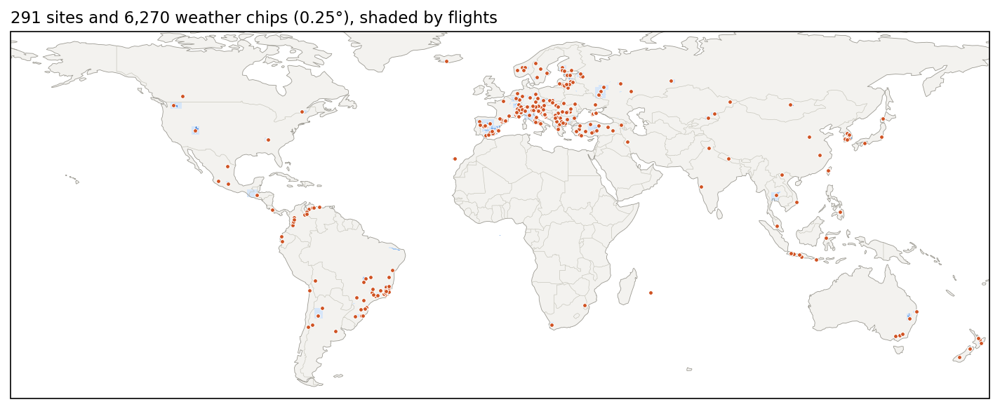

# Database statistics

Generated from the database by `scripts/repo_stats.py` (notebook 12) on 2026-11-19. Counts and aggregates only; pilot names and tracks stay private.

Interactive maps (GitHub draws them): [sites](sites.geojson), [weather chips](chips.geojson), [the 5,000 cells crossed most often, by how often pilots found a climb](thermal_cells.geojson). Close-ups: [Europe](coverage_europe.png), [the Americas](coverage_americas.png).

## Totals

| | |
|---|---|
| Competitions | 848 |
| Tasks | 3,114 |
| Tasks with results | 2,325 |
| Results | 173,280 |
| Pilots | 12,495 |
| IGC tracks | 196,975 |
| Unique tracks | 165,112 |
| Unique flights | 152,930 |
| Drives found (not flights) | 2,173 |
| Sites | 291 |
| Site-chip pairs (a chip can serve several sites) | 8,589 |
| 1 km cells | 3,913,750 |
| Climbs | 3,718,937 |
| Glides | 3,856,342 |
| Cell crossings | 18,603,747 |
| Thermals | 2,959,898 |
| Landings | 152,930 |

Median flight: 2.56 h, 20 thermals at 1.47 m/s.

## Unique tracks by source

| Source | Tracks |
|---|---|
| airtribune | 79,448 |
| civlcomps | 64,971 |
| airscore | 12,873 |
| flymaster | 7,820 |

## By year

| Year | Competitions | Tasks | Flights |
|---|---|---|---|
| 2015 | 11 | 24 | 383 |
| 2016 | 38 | 168 | 2,634 |
| 2017 | 47 | 167 | 3,467 |
| 2018 | 42 | 142 | 4,507 |
| 2019 | 32 | 106 | 3,253 |
| 2020 | 26 | 103 | 3,742 |
| 2021 | 39 | 167 | 6,452 |
| 2022 | 51 | 204 | 14,643 |
| 2023 | 39 | 144 | 10,488 |
| 2024 | 79 | 296 | 19,930 |
| 2025 | 216 | 782 | 41,926 |
| 2026 | 233 | 811 | 41,505 |

## Weather tables

| Table | Rows | Chips | Days |
|---|---|---|---|
| `era5_single` | 8,014,876 | 6,270 | 2083 |
| `era5_levels` | 2,581,720 | 6,270 | 2073 |
| `era5_extra` | 3,964,016 | 6,270 | 2083 |
| `era5_land` | 63,561,788 | 6,249 | 2084 |
| `era5_static` | 6,270 | 6,270 |  |

## Competitions by country (top 20)

| Country | Competitions |
|---|---|
| ? | 69 |
| BRA | 66 |
| FRA | 64 |
| COL | 58 |
| ESP | 56 |
| ITA | 53 |
| RUS | 32 |
| USA | 26 |
| MKD | 24 |
| TUR | 24 |
| AUT | 23 |
| SLO | 22 |
| AUS | 17 |
| KOR | 17 |
| LTU | 16 |
| CHE | 15 |
| SVN | 15 |
| MEX | 14 |
| ROU | 14 |
| VEN | 13 |

## Sites with the most flights

| Site | Country | Competitions | Flights | Years |
|---|---|---|---|---|
| Krusevo, North Macedonia | MKD | 33 | 10,605 | 2016–2026 |
| Roldanillo, Colombia | COL | 35 | 9,647 | 2016–2026 |
| Tolmin, Slovenia | SLO | 21 | 6,283 | 2016–2026 |
| Romano d Ezzelino, Italy | ITA | 15 | 6,064 | 2020–2026 |
| Chelan, United States | USA | 17 | 6,008 | 2022–2026 |
| Gemona, Italy | ITA | 14 | 5,855 | 2021–2026 |
| Laragne-Montéglin | FRA | 11 | 4,575 | 2019–2026 |
| Pedavena, Italy | ITA | 11 | 4,026 | 2016–2026 |
| Valle De Bravo | MEX | 10 | 3,705 | 2017–2026 |
| Pegalajar | ESP | 8 | 3,607 | 2015–2026 |
| St-Jean-Montclar, France | FRA | 10 | 2,694 | 2018–2026 |
| Piedechinche | COL | 11 | 2,307 | 2016–2026 |
| Ager, Spain | ESP | 7 | 2,240 | 2017–2026 |
| Castelo | BRA | 6 | 2,158 | 2016–2026 |
| Werfenweng | AUT | 4 | 2,117 | 2024–2026 |
| Le Grand-Bornand, France | FRA | 6 | 2,090 | 2016–2026 |
| Andradas | BRA | 7 | 2,022 | 2023–2026 |
| Pedro Bernardo, Spain | ESP | 7 | 1,825 | 2015–2026 |
| Monroe | USA | 9 | 1,813 | 2022–2026 |
| St Andre, France | FRA | 10 | 1,764 | 2024–2026 |
| Fellering, France | FRA | 10 | 1,677 | 2017–2026 |
| Piedrahita, Spain | ESP | 8 | 1,587 | 2016–2026 |
| Governador Valadares | BRA | 4 | 1,537 | 2025–2026 |
| Adeje | ESP | 4 | 1,459 | 2022–2025 |
| SUMEDANG | IDN | 3 | 1,442 | 2024–2026 |
| Mungyeong | KOR | 6 | 1,341 | 2024–2026 |
| Aksaray Turkey | TUR | 3 | 1,335 | 2023–2025 |
| Nis, Serbia | SRB | 6 | 1,312 | 2015–2026 |
| Algodonales | ESP | 4 | 1,252 | 2018–2026 |
| Denizli, Turkey | TUR | 6 | 1,241 | 2017–2024 |

## Gliders

Class found for 94.2% of results; harness written for 13.9%.

| Class | Share of results |
|---|---|
| CCC | 33.4% |
| EN-C | 33.3% |
| EN-D | 21.3% |
| EN-B | 11.7% |
| EN-A | 0.2% |

Pilot ratings: 12,060 pilots (2,181 with 20+ tasks), from 999 to 2366 (median 1477).

## Models (latest run)

Thermal model, chance of finding a climb when crossing a cell, scored on sites left out:

| Features | AUC | Log-loss skill |
|---|---|---|
| pilot + terrain | 0.654 | +4.8% |
| + sun | 0.662 | +5.4% |
| + weather | 0.671 | +5.9% |

Task baseline without weather (mean absolute error):

| Target and split | Model | Median of all tasks |
|---|---|---|
| winner_kmh, new competition | 4.9 km/h | 6.1 km/h |
| winner_kmh, new site | 5.2 km/h | 6.1 km/h |
| goal_share, new competition | 19.6 points | 26.0 points |
| goal_share, new site | 20.5 points | 26.0 points |

Wind pilots measured vs ERA5 at the same height:

| Band | Groups | Direction error | Within 30° | Speed correlation |
|---|---|---|---|---|
| near the ground | 12,121 | 22° | 63% | 0.39 |
| middle | 10,988 | 22° | 64% | 0.45 |
| free air | 11,783 | 16° | 74% | 0.61 |
